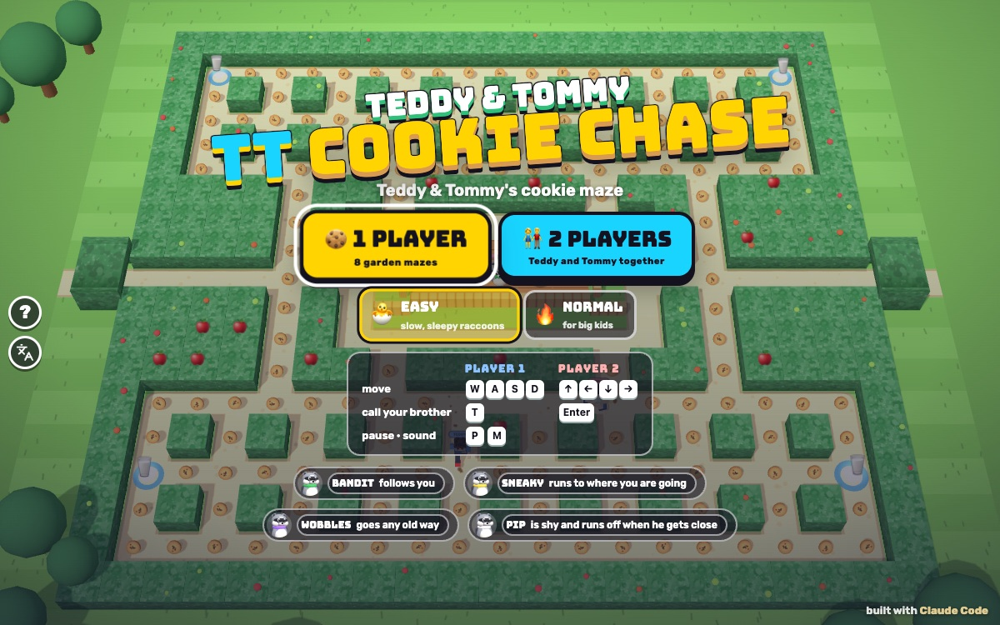

# TT Cookie Chase

[](https://adong.github.io/cookie-chase-tt/)

Press **?** any time (or tap the round **?** button on the left edge) to see the keys. The game waits while you look.
Tap the language button under it (the A文 icon) to switch between English and 中文; the dashboard and every game remember the choice.

**中文：** 花园迷宫里吃饼干：躲开四只调皮的饼干浣熊，喝牛奶让它们犯困，8 个迷宫，单人或 Teddy 和 Tommy 一起玩。

A maze-chase game starring Teddy and Tommy, built with Claude Code from plain JavaScript and Three.js on the shared Claude Games kit.
You run round a 3D kitchen-garden maze eating every cookie while four Crumb Raccoons try to catch you. Drink the milk and they get sleepy, so you can bonk them back to their den.
There are no image, model or audio files: the boys are the kit's blocky characters, the raccoons are built from spheres, every texture is painted on a canvas, and every sound is synthesised.
Nobody gets hurt: getting caught means getting tickled, and a bonked raccoon just zooms home with stars round its head.

The name lives in one place, `CC.TITLE` in `js/title.js`. Change it there (and in the `<title>` of `index.html`) and the logo, menus and the ? panel follow.

## Play

- **Double-click `index.html`.** It works offline because Three.js and the kit are copied into `kit/`. Without internet the title font falls back to Arial Black.
- **Send one file:** `dist/cookie-chase-tt.html` is the whole game in one file, about 840 KB. AirDrop or email it, then open it in a browser.
- Rebuild that file after any edit: `python3 kit/tools/bundle.py . --name cookie-chase-tt`

Pick **🍪 1 PLAYER** or **👫 2 PLAYERS**, and a difficulty, on the title screen. Then pick your hero and the maze (any maze you've reached so far; the dots show which you've cleared).

| Difficulty | |
|---|---|
| 🐣 **EASY** (the default), for Tommy (5) | 5 hearts (6 shared in 2 players). Slow raccoons that wander about more, come out of the den later and stay sleepy for 10 s after the milk. |
| 🔥 **NORMAL**, for Teddy (8) | 3 hearts (4 shared). Quicker raccoons that chase properly, and shorter milk (7 s, less in later mazes). |

## Rules

- **Eat every cookie 🍪 to clear the maze.** The cookie count is at the top. When only 6 are left they grow and glow so they're easy to find.
- **The Crumb Raccoons** start in their den in the middle and come out through the pink gate one by one. Each has a coloured scarf, his own name and his own way of chasing:

  | | Raccoon | |
  |---|---|---|
  | 💚 | **BANDIT** | follows you |
  | 💛 | **SNEAKY** | runs to where you're going (a few cells ahead of you) |
  | 💜 | **WOBBLES** | goes any old way |
  | 🤍 | **PIP** | is shy: comes for you from far away, and runs off to his corner when he gets close |

  Every so often they all wander off to their own corners for a few seconds (more often on Easy), and they slow down in the tunnels.
- **The milk 🥛** (one in each corner of the maze): the raccoons turn sleepy and blue, yawn 💤, turn round and dawdle. Run into one to **BONK!** it: it zooms back to the den with stars round its head and comes out again a moment later. Bonks in a row score 200, 400, 800, 1600. They blink just before they wake up, and a bar at the top shows how long the milk lasts.
- **The tunnel** on each side of the maze goes through a leafy arch and comes out on the other side.
- **Fruit:** twice in every maze (after about 30% and 70% of the cookies) a fruit appears just below the den for a few seconds, a different one in each maze (🍓 🍒 🍎 🍊 🍇 🍐 🍑 🍍).
- **Getting caught:** you sit down giggling ("HEE HEE!") while the raccoon tickles you, lose a heart, and pop back at the start, blinking (safe) for 2 s. The raccoons go home too.
- **2 players:** Teddy and Tommy share the cookies and the hearts. A tickled brother stays put calling "HELP!" for up to 7 s: run into him to get him back on his feet (✋ HIGH FIVE!), and no heart is lost. If nobody comes, he pops back at the start and a heart goes.
- **Clearing a maze:** the boy who ate the last cookie does his signature move: Teddy shadow-boxes, then sinks a 🏀 jump shot (SWISH!); Tommy does his Y pose ✌️. Confetti, and the raccoons sit down for a nap. Then **NEXT MAZE ▶**, with your score and your best score (kept for each difficulty).
- **Scores:** a cookie is 10, the milk 50, a bonk 200 and up, fruit 100 to 2,000.
- **Out of hearts:** "OOPS!" and TRY AGAIN restarts the same maze.
- Each maze is a little faster than the one before. Clear all 8 and it's "YOU DID IT!".

| | Maze | |
|---|---|---|
| 1 | 🌷 **SUNNY GARDEN** | long straight paths, tulips on the hedges |
| 2 | 🍎 **APPLE ORCHARD** | rows of little trees, junctions everywhere |
| 3 | 🥕 **CARROT ROWS** | long rows like a vegetable patch |
| 4 | 🎃 **PUMPKIN PATCH** | big square beds, an autumn sky |
| 5 | 🍓 **STRAWBERRY FIELD** | berry bushes, a pink sky |
| 6 | 🌻 **SUNFLOWER LANE** | loops round the flower beds |
| 7 | 🧺 **PICNIC PARK** | zigzags and stairs |
| 8 | 🍄 **MOONLIGHT GARDEN** | at night, under the moon |

The mazes are this game's own, drawn by hand as text in `js/mazes.js` (21 × 19, mirrored left-right). None of them copies an arcade maze, and the raccoons' names, colours and personalities are our own.

## Controls

| | Player 1 | Player 2 | Touch |
|---|---|---|---|
| move | W A S D | ↑ ← ↓ → | swipe anywhere (or the optional round d-pad) |
| call your brother | T | Enter | the big button with his face |

- **Press early:** a turn is remembered until it can happen, so you can press (or swipe) before you reach a corner and he turns there. Going back the way you came is instant. At a plain bend he goes round it by himself.
- In 1 player both key sets work, so arrows are fine too.
- **Swipes:** a small slide of your finger is enough, and you can keep steering without lifting it. A big arrow flashes to show the swipe was seen. With two players on one iPad, the left half of the screen steers player 1 and the right half player 2.
- **D-pads:** on a touch screen, **🎮 D-PAD** on the title screen turns on a round pad (thumb on it, slide to steer). In 2 players each brother gets his own pad in his corner, with his companion button beside it.
- **P** or Esc pauses and **M** turns the sound on or off. The ❚❚ and 🔊 buttons at the top do the same.
- **Menus:** ← → pick 1 or 2 players, ↑ ↓ switch Easy / Normal, Enter goes, 1 and 2 jump straight in. On the hero screen A D (and ← →) pick the heroes, W S pick the maze, Enter goes and Esc goes back.

## Companion

Your companion is the other brother: **Tommy** comes for Teddy, and **Teddy** comes when Tommy is the one playing (`Kit.roster.buddyFor`). In 2 players, T calls Teddy's helper and Enter calls Tommy's, the same way for either brother.

- **Calling him:** press **T** (player 2: **Enter**) or tap the big button with his face, any time and as often as you like. He pops in right beside you, at his smaller buddy size, in a puff of confetti.
- **STOP!** He shouts it straight away and every raccoon freezes for 3 s, hands up, with a 🛑 over its head. Frozen raccoons can't catch anyone. "TOMMY SAYS: GO GO GO!"
- **His signature move:** Tommy does his Y pose with peace fingers; Teddy shadow-boxes, jab and straight.
- **A treat:** he tosses you a 🍦 💧 🧃 🍪 🍉 or 🍌, which you carry for a few seconds ("🍦 ICE CREAM FROM TOMMY!").
- **MUNCH!** He munches the cookies right around him (two steps along the paths each way), and they count for you.
- **Bye:** Tommy waves his Y again, Teddy sinks a 🏀 jump shot, and he's gone in a puff after about 4.6 s.
- **Call him again** (while he's there or after) and he does it all again: another STOP!, another treat, more munching. So Tommy can protect you as long as you keep calling him.
- **2 players:** calling your brother while you're the tickled one gets you straight back on your feet.
- The bar next to his face (top left, and the ring round the big button) shows how long he's staying.

## How it works, and how it's tested

- `js/engine.js` has the rules and no Three.js. Everyone moves from cell centre to cell centre along the paths (an entity is in a cell and some way toward the next one), so walls can't be crossed and the tunnels just wrap the column number. It reports what happened as events, which `js/game.js` turns into effects, sounds and banners.
- `js/brain.js` is the autopilot (the demo behind the title screen, and the soak test). For every cell it works out the soonest an awake raccoon could get there, and only takes paths where the boy gets there clearly first.
- **Headless checks**, in Node with no npm, or in the browser console:

```bash
node tools/check.js
```

```bash
node tools/check.js --all --seeds=3
```

```js
game.check()      // every maze: cookies and milk reachable, den gate open, tunnels paired, no dead ends
game.sabotage()   // broken mazes and a cheating mover: the checks must catch every one
game.tunnels()    // walk a boy and a raccoon out of each side of each tunnel
game.walls()      // random steering on every maze, watching that nobody is ever inside a hedge
game.soak({ n: 0, diff: 'easy' })   // the autopilot plays a maze
```

- The maze check fails a maze if a cookie or milk can't be reached from the start (or either 2-player start), a raccoon can't get out of the den through the gate, the gate opens into a hedge, a tunnel has no partner on the other side, there's a dead end, or there aren't exactly 4 milks.
- The wall watch checks every boy, raccoon and companion after every step: nobody may stand in, or be walking into, a hedge or the den fence (only raccoons going in or out may use the gate and the den).
- At the last check:
  - all 8 mazes passed, and all 6 sabotage cases were caught (a walled-in cookie, a shut den gate, a one-sided tunnel, a dead end, a boy pushed into a hedge, a raccoon walking through the den fence);
  - 32 trips through the tunnels (a boy and a raccoon, each way, in every maze) all came out on the other side;
  - 1,036,800 watched steps of random steering (1 and 2 players, Easy and Normal, every maze, `--seeds=6`) never put anyone in a hedge;
  - the autopilot cleared mazes 1 to 3 on Easy in 18 of 18 runs without getting stuck (`node tools/check.js --seeds=6`);
  - in the full soak (`--all --seeds=3`) it cleared all 192 runs: every maze, Easy and Normal, 1 and 2 players, with and without calling the companion. Without the companion it was caught once on Easy and 24 times on Normal in 1 player (12 in 2 players); calling the companion brought that to 0 and 1.
- Console hooks (`window.game`) for testing in a browser whose animation is throttled:

```js
game.start({ two: false, diff: 'easy', heroes: ['tommy'], maze: 0 })  // jump into a maze
game.step(1)          // advance 1 s and draw
game.press(0, 'left', 0.5)   // steer player 1 for half a second
game.put(0, 1, 16, 0)        // put player 1 at a cell, heading up
game.buddy(0)         // call player 1's brother
game.almost(0)        // eat every cookie but one and put player 1 next to it
game.cam({ x: 10, y: 9, d: 16 })   // close-up camera on a cell (null to let go)
game.hold(true)       // stop the live loop so only step() moves time
```

## Files

```
index.html        page, HUD, menus, touch controls (CSS inline), the tab and home-screen icon (🍪 on mint #8ee3b0)
js/title.js       the game's name
js/config.js      tuning numbers, fruits, the raccoons' names and scarves, pickable heroes
js/mazes.js       the 8 hand-made mazes and their garden themes, the maze parser, grid helpers
js/engine.js      the rules: movement, tunnels, raccoons, milk, fruit, tickles and rescues, the companion
js/brain.js       the autopilot (title-screen demo, soak)
js/check.js       maze check, wall watch, tunnel trips, soak, sabotage
js/input.js       keyboard for two players, swipes, d-pads
js/sfx.js         sounds on top of Kit.sound
js/art.js         the garden maze, cookies, the raccoons, effects
js/game.js        scene, camera, characters and poses, effects, the companion's visits, HUD, menus, loop, window.game
js/keys.js        the keys the ? panel shows (Kit.help)
js/zh.js          中文: every word on the page, the toasts and banners, the ? panel, and HEE HEE! / BONK! / STOP! (Kit.lang)
tools/check.js    runs js/check.js in Node
kit/              copy of ~/claude-games/kit (python3 ../kit/tools/sync.py .), never edited here
dist/cookie-chase-tt.html   the single-page build
```

## Kit candidates

These live in this game's own JS for now:

- **Grid movement** (`js/engine.js`): centre-to-centre movement with a remembered next turn, instant turn-backs, self-rounding bends and wrap-around tunnels. Any maze or grid game could use it.
- **A raccoon** (`js/art.js`, `makeRaccoon`): a chubby critter from spheres with a tint (for sleepy blue) and eyelids.
- **Swipe steering** (`js/input.js`): swipe anywhere, keep steering without lifting, split-screen halves for two players.
- **Poses** (`js/game.js`): `poseGiggle` (sitting, rocking with laughter), and `celebrate` / `settle` / `plantFeet` from BombasTTic!.

## Not verified

- **Sound:** the synth code runs without errors, but nobody has listened to it.
- **Real touch devices:** swipes, the d-pads and the companion buttons were tested with synthetic touch pointer events in the browser at phone (390 × 844, 740 × 360) and iPad (1024 × 768, 768 × 1024) sizes, not on a real phone or iPad. Two thumbs at once on one iPad is untested.
- **Double-click from Finder (`file://`):** the page only uses classic `<script src>` tags and makes no network requests (apart from the optional Google font), but it was tested over `http://localhost`, because the test browser can't drive `file://` pages.
- **Fun:** the checks and the autopilot say every maze can be cleared. Whether Easy is easy enough for a 5-year-old, and Normal right for an 8-year-old, needs Tommy and Teddy.
